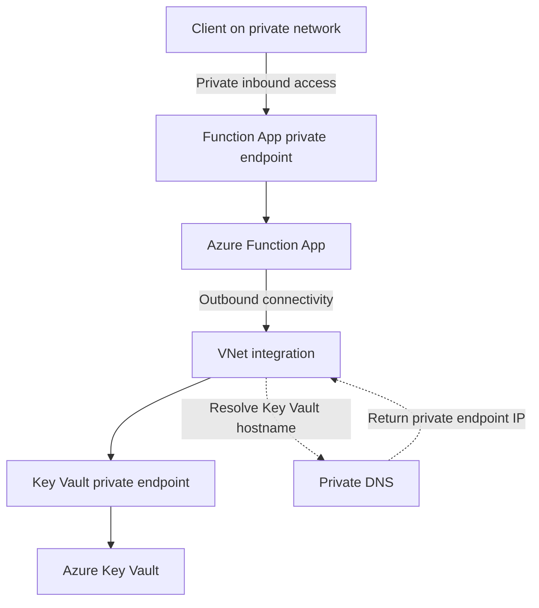

## Azure Zero Trust Serverless API

A Terraform-driven Azure cloud engineering project demonstrating private networking, managed identity, role-based access control (RBAC), and infrastructure automation using Azure Functions and Key Vault.

## Project Overview

The goal of this project is to design and validate a serverless API architecture using Zero Trust security principles.

The architecture includes:

- An Azure Function App running Python 3.11.
- VNet integration for outbound network connectivity.
- Private endpoints for the Function App, Azure Key Vault, and Azure Storage.
- Private DNS for resolving Azure service hostnames to private endpoint IP addresses.
- System-assigned managed identity and Azure RBAC for identity-based secret access.
- Terraform for infrastructure provisioning.
- Application Insights and Log Analytics for observability.

The project also documents security findings discovered during validation, including permissive public inbound access rules on the Function App and SCM deployment endpoint.

**Project status**: Terraform configuration validation and automated code tests passed. Private-only access enforcement and live end-to-end Key Vault integration remain outstanding.


## Architecture Overview



## Validation Results

The following checks were completed during the
Validate phase of the project:

| Validation | Result |
|---|---|
| Ruff static analysis | PASS |
| Python unit tests | PASS (4/4) |
| Source-only deployment ZIP structure | PASS |
| Terraform validation | PASS (4/4 stacks) |

### Validation Scope

These checks confirm code quality, expected unit-test
behavior, deployment package structure, and Terraform
configuration validity.

They do not independently prove that the deployed
Function App can retrieve secrets from Key Vault.

Live end-to-end verification remains a documented
follow-up.


## Security Design and Findings

### Implemented Security Controls

- Private endpoints for Azure Functions, Key Vault,
  and Azure Storage.
- VNet integration for outbound connectivity.
- Private DNS for private endpoint resolution.
- System-assigned managed identity for authentication.
- Azure RBAC for Key Vault secret authorization.
- Centralized monitoring with Application Insights
  and Log Analytics.

### Security Finding: Public Inbound Access

During validation, the Function App and its SCM
deployment endpoint were found to have permissive
public inbound access rules.

Although private endpoints were configured,
their presence alone did not disable public access.

This means the private-only networking objective
was not fully enforced.

### Required Remediation

- Restrict or disable public network access to the
  Function App and SCM endpoint.
- Confirm that authorized clients can still reach
  the application through its private endpoint.
- Ensure the deployment workflow can reach the
  private SCM endpoint.
- Revalidate access restrictions after remediation.

**Status:** Security finding documented; remediation
and live verification remain outstanding.


## API Endpoints

The Azure Function App exposes two HTTP endpoints.

### Health Check

`GET /api/health`

Returns the application's health-check response.

A successful HTTP 200 response confirms that the
health endpoint is responding, but does not prove
Key Vault connectivity.

### Key Vault Secret Check

`GET /api/secret-check`

Attempts to retrieve the `demo-config` secret
from Azure Key Vault.

The Function App uses `DefaultAzureCredential`
to obtain credentials through its system-assigned
managed identity in Azure.

Azure RBAC grants the identity permission to
retrieve secrets using the Key Vault Secrets User
role.

**Validation note:** Unit tests cover successful
and failed secret retrieval using mocks.
Live end-to-end secret retrieval has not yet
been independently verified.


## Deployment

### Infrastructure Deployment

Infrastructure is provisioned using Terraform.

The four stacks are deployed in this order:

1. `00-bootstrap` — Terraform remote state
2. `10-core` — Networking, private DNS, monitoring
3. `20-private-services` — Key Vault, Storage,
   and private endpoints
4. `30-workload` — Function App and managed identity

Standard Terraform commands:

```bash
terraform init
terraform plan
terraform apply
```

Each stack must be initialized and deployed
using its appropriate configuration and state.

### Application Packaging

The Function App is packaged using:

`scripts/build-function-package.ps1`

The source-only deployment ZIP includes:

- `function_app.py`
- `host.json`
- `requirements.txt`

Python dependencies are not bundled into the ZIP.

### Remote Build

The Function App runs Python 3.11 on Linux.

Azure Oryx remote build installs dependencies
from `requirements.txt` in the target environment.

This avoids relying on locally built Windows
Python dependencies for a Linux deployment.

### Deployment Considerations

The Function App has a private endpoint.

When public SCM access is restricted, the
deployment runner must have network connectivity
to the private SCM deployment endpoint.

A successful Azure authentication does not
guarantee that the deployment endpoint is
network-reachable.


## Repository Structure

```text
azure-zero-trust-serverless-api/
├── app/
│   ├── function_app.py
│   ├── host.json
│   └── requirements.txt
├── infra/
│   └── stacks/
│       ├── 00-bootstrap/
│       ├── 10-core/
│       ├── 20-private-services/
│       └── 30-workload/
├── scripts/
│   └── build-function-package.ps1
└── README.MD
```


## Future Improvements

The following improvements would strengthen the
architecture and its deployment workflow:

- Restrict public access to the Function App and
  SCM deployment endpoint.
- Implement a CI/CD workflow with private network
  access to the deployment endpoint.
- Perform live end-to-end Key Vault secret retrieval
  validation.
- Add automated security scanning.
- Pin Python dependency versions for reproducibility.
- Add API Management and OpenAPI documentation.

## Lessons Learned

This project reinforced several cloud engineering
concepts:

- Private endpoints do not automatically disable
  public access.
- VNet integration enables outbound connectivity,
  while private endpoints provide private access
  to individual services.
- Private DNS resolves service hostnames to
  private endpoint IP addresses.
- Managed identity handles authentication,
  while RBAC controls authorization.
- Passing unit tests and Terraform validation
  does not guarantee successful live integration.
- A successful health check does not prove
  downstream dependencies are functioning.

## License

MIT License.


