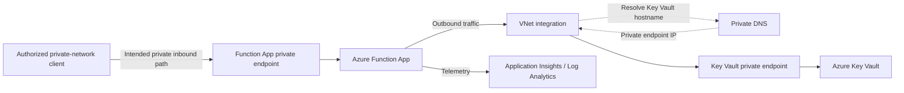

# Azure Zero Trust Serverless API

A Terraform-driven Azure cloud engineering project exploring Zero Trust design through **private networking, managed identity, role-based access control (RBAC), and explicit security validation**.

The application is an HTTP-triggered Azure Function with a health endpoint and a Key Vault integration check. The repository documents both the intended architecture and the differences between configuration, automated tests, and verified live behavior.

> **Project status:** Ruff static analysis, four Python unit tests, source-only deployment-package checks, and Terraform validation for all four stacks passed during the project's validation phase. A live HTTP 200 response was observed from `/api/health`. The published evidence does **not** yet establish private-only access for both the Function App and SCM endpoint, or successful live end-to-end Key Vault secret retrieval. Those are tracked as follow-up checks.

## What This Project Demonstrates

- **Infrastructure as code:** Four Terraform stacks with separate state and responsibilities.
- **Private network design:** VNet integration, private endpoints, and linked private DNS zones for Azure services.
- **Identity and authorization:** A system-assigned managed identity and the **Key Vault Secrets User** RBAC role for the Function App.
- **Application development:** A Python Azure Function exposing health and secret-retrieval checks.
- **Observability:** Application Insights and Log Analytics.
- **Validation and troubleshooting:** Tests, deployment-package checks, security findings, and distinction between application reachability and downstream access.

## Architecture



The diagram shows the **intended private access path**; it is not proof that every live endpoint and deployment path has been independently verified.

Terraform defines the environment using these stacks, applied in dependency order:

| Stack | Responsibility |
|---|---|
| `00-bootstrap` | Terraform remote-state resources |
| `10-core` | VNet, subnets, private DNS, and monitoring |
| `20-private-services` | Key Vault, Storage, and private endpoints |
| `30-workload` | Linux Function App, managed identity, RBAC, and Function App private endpoint |

## Security Design and Findings

### Configured Controls

| Area | Configuration |
|---|---|
| Function App | HTTPS-only; `public_network_access_enabled = false` in the current Terraform source |
| Key Vault | Public network access disabled; private endpoint; Azure RBAC |
| Storage | Public network access disabled; Blob private endpoint |
| Function identity | System-assigned managed identity |
| Secret access | `Key Vault Secrets User` role assigned to the Function App identity |
| Outbound network | VNet integration and private DNS resolution |
| HTTP endpoints | Function-level authorization is configured in the application |

**Configuration is not live verification.** The repository establishes the intended settings, but a deployed resource's actual state and reachability must be checked separately.

### Finding: Private Endpoint Did Not Imply Private-Only Access

During an earlier assessment, the Function App and its **SCM (deployment) endpoint** had permissive public inbound access rules despite an approved private endpoint. That is a security finding because deploying a private endpoint does not, by itself, prove that public entry points have been disabled.

The current Function App Terraform source sets `public_network_access_enabled = false`. The remaining validation is to confirm that the deployed Function App and SCM endpoint both enforce the intended access restrictions and remain reachable only from authorized network paths.

### Deployment Implication

GitHub Actions can authenticate to Azure successfully and still receive HTTP 403 when its runner cannot access a private SCM deployment endpoint. Identity authorization and network reachability are distinct requirements. A private deployment path must be designed and tested before claiming end-to-end CI/CD deployment success.

## API Endpoints

The Azure Function application defines two GET endpoints. The application is configured with **function-level HTTP authorization**, so callers require the applicable function key in addition to network access.

### `GET /api/health`

Returns a JSON health response, including a status and UTC timestamp. An observed HTTP 200 establishes that the endpoint responded; it does **not** establish Key Vault access or complete security compliance.

### `GET /api/secret-check`

Uses `DefaultAzureCredential` and the Azure Key Vault SDK to request a secret (default name: `demo-config`). In Azure, the intended authentication mechanism is the Function App's system-assigned managed identity, with Azure RBAC authorizing secret retrieval. The success response reports retrieval metadata **without returning the secret value**.

Unit tests covered success and failure paths using mocks. **Successful live end-to-end retrieval has not yet been independently established in the published validation record.**

## Validation Results

These results were recorded during the validation phase:

| Check | Recorded result | What it establishes |
|---|---|---|
| Ruff static analysis | PASS | Python static checks passed |
| Python unit tests | PASS (4/4) | Tested application behavior passed under mocked conditions |
| Source-only ZIP structure | PASS | Deployment archive included the required application files |
| Terraform validation | PASS (4/4 stacks) | Terraform configuration was structurally valid |
| Live `/api/health` request | HTTP 200 observed | The health endpoint responded at the time of the test |

Passing these checks does not, on its own, verify deployed networking, successful private SCM deployment, or live Key Vault retrieval.

## Building and Deploying

The source of truth for the Azure Function code is:

`infra/stacks/30-workload/app/`

The included packaging script is:

```powershell
./scripts/build-function-package.ps1
```

It stages `function_app.py`, `host.json`, and `requirements.txt` into a source-only ZIP. Python dependencies must be installed in a compatible Linux environment as part of the deployment workflow; the local archive does not bundle Windows-built dependencies.

The `30-workload` Terraform configuration currently specifies a **Linux B1 plan** and a **Python 3.12.9** application stack. Confirm that this setting matches the runtime actually deployed before documenting a live runtime version.

For each Terraform stack, work from the appropriate stack directory and review the plan before applying changes:

```bash
terraform init
terraform validate
terraform plan
```

Apply infrastructure only when needed for a live test, bearing in mind that compute, private endpoints, storage, and monitoring may incur charges.

## Repository Structure

```text
azure-zero-trust-serverless-api/
├── app/
│   └── function-api/
│       └── host.json
├── infra/
│   └── stacks/
│       ├── 00-bootstrap/
│       ├── 10-core/
│       ├── 20-private-services/
│       └── 30-workload/
│           └── app/
│               ├── function_app.py
│               ├── host.json
│               └── requirements.txt
├── scripts/
│   └── build-function-package.ps1
└── README.MD
```

The tree is abbreviated to highlight key files and folders.

## Outstanding Work

- Verify public access is disabled for both the **deployed Function App and SCM deployment endpoint**, including negative tests from outside authorized networks.
- Verify live `/api/secret-check` access from an authorized private network path, including DNS resolution, managed identity, and RBAC.
- Validate a deployment runner and release workflow with network connectivity to the private SCM endpoint.
- Pin application dependency versions and verify the Python runtime against the deployed environment.
- Add automated security scanning and, optionally, API Management and OpenAPI documentation.

## Lessons Learned

- A private endpoint does **not** automatically disable public entry points.
- VNet integration handles outbound connectivity; private endpoints provide private entry points to individual services.
- Private DNS determines whether a service hostname resolves to the intended private endpoint IP.
- Managed identity answers *who the application is*; RBAC determines *what it is allowed to do*.
- A successful health check does not prove downstream dependencies are working.
- Valid Terraform and passing unit tests do not replace live integration and security validation.
- Azure authentication success alone does not prove that a CI runner can reach a private SCM deployment endpoint.


